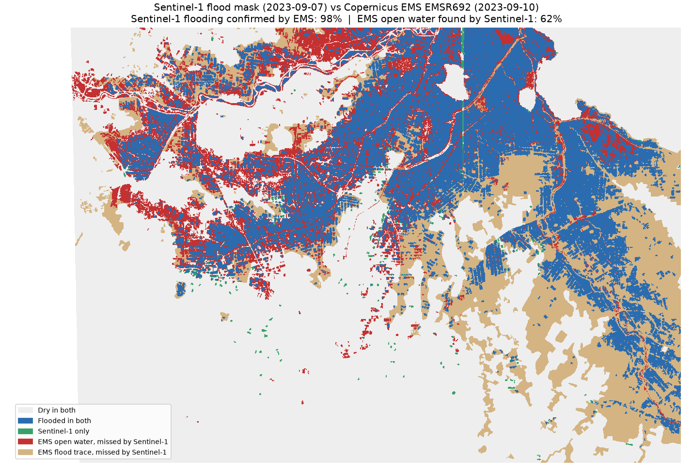

# Thessaly Flood Mapping: Sentinel-1 vs Copernicus EMS

Mapping the September 2023 Storm Daniel flood in the Thessaly plain (Greece) from free Sentinel-1 radar imagery, and validating the result against the official Copernicus Emergency Management Service flood delineation (activation EMSR692).



## Key findings

- **98%** of the area flagged as flooded by Sentinel-1 (7 Sep 2023) is also flooded in the Copernicus EMS map (10 Sep 2023), so the method produces very few false alarms.
- Sentinel-1 found **62%** of the EMS open-water area, but only **45%** of all EMS flooding. Most of the gap is EMS *flood trace* (receded, wet or debris-covered ground), which a water threshold is not designed to detect.
- The two mapped areas changed in **opposite directions** between the two dates. Around Palamas, half of the water seen on 7 Sep was mapped as flood trace by 10 Sep (receding). Around Karditsa, EMS mapped more open water than Sentinel-1 had seen (still spreading). Much of the disagreement reflects the flood moving during the 3-day gap rather than a method error.
- A timeline from three Sentinel-1 orbits shows the plain flooding between 6 and 7 Sep (about 1 km² newly flooded on 6 Sep, about 225 km² on 7 Sep), then draining to about 6 km² by 19 Sep.
- 44 of 8,312 OpenStreetMap buildings fall inside the Sentinel-1 flood mask, and 299 more lie next to it.

## Study area and data

| Item | Value |
|---|---|
| Area | Thessaly plain between Karditsa and Palamas, bbox 21.70–22.20 E, 39.30–39.55 N |
| Radar | Sentinel-1 RTC (VV), Microsoft Planetary Computer; relative orbit 102, 26 Aug 2023 (before) and 7 Sep 2023 (after); orbits 80 and 7 for cross-checks |
| Reference | Copernicus EMS EMSR692, delineation products for AOI02 Palamas and AOI05 Karditsa, imagery of 10 Sep 2023 |
| Buildings | OpenStreetMap |
| Grid | 20 m, UTM zone 34N (EPSG:32634) |

## Method

1. **Change detection.** Load the before and after scenes from the same orbit and convert VV backscatter to dB.
2. **Flood mask.** A pixel is newly flooded if VV is below −18 dB after the event, was not below it before, and dropped by more than 3 dB. A 3×3 median filter reduces speckle, and patches smaller than 1 ha are removed. Thresholds of −15 and −20 dB were tested for sensitivity.
3. **Consistency checks.** The same method was run on other orbits and dates to build a flood timeline and to compare orbits.
4. **Exposure.** OpenStreetMap buildings were classified as flooded, next to flooding, or not flooded.
5. **Validation.** The EMS *observed event* polygons were rasterized onto the 20 m grid and compared with the Sentinel-1 mask inside the EMS areas of interest. EMS *Flooded area* (open water) and *Flood trace* were evaluated separately.

## Validation results

| Area | EMS layer | Sentinel-1 flooding confirmed by EMS | EMS flooding found by Sentinel-1 | IoU |
|---|---|---|---|---|
| Palamas | Open water | 50% | 82% | 0.45 |
| Karditsa | Open water | 87% | 55% | 0.51 |
| Both | Open water | 69% | 62% | 0.49 |
| Both | All flooding (open water + trace) | 98% | 45% | 0.45 |

Full table: [`outputs/ems_comparison.csv`](outputs/ems_comparison.csv)

## Limitations

- **Three-day gap** between the Sentinel-1 image (7 Sep) and the EMS reference (10 Sep), during which the flood was still moving.
- **Thresholding detects open water only.** Shallow water under vegetation and flooding between buildings are likely missed. A check of backscatter change at building locations found no clear urban flooding signal: buildings near flooding showed a strong increase about as often as buildings far from it (12.5% vs 11.1%).
- **EMS is a reference, not ground truth.** It is derived from very-high-resolution optical imagery by semi-automatic extraction and photo-interpretation, and parts of its area were not analysed.
- A visible seam where two Sentinel-1 scenes are joined, and a 20 m grid that smooths small features.

## How to run

```bash
pip install -r requirements.txt
```

Download the reference data (not included in this repository):

1. Open https://mapping.emergency.copernicus.eu/activations/EMSR692 and go to **Download Products**.
2. For **AOI 02 Palamas** and **AOI 05 Karditsa**, download **Vector data** of the product named **Delineation** (image of 10 Sep 2023).
3. Extract both zip files into `data/ems/`, keeping the original folder names.

Then run the scripts in order:

```bash
python search_scenes.py
python compare_dates.py
python flood_mask.py
python cross_check_orbit.py
python flood_timeline.py
python download_buildings.py
python building_exposure.py
python urban_signal.py
python compare_ems.py
```

## Data credits

- Contains modified Copernicus Sentinel data (2023), accessed through Microsoft Planetary Computer.
- Flood delineation: © European Union, Copernicus Emergency Management Service, EMSR692.
- Buildings: © OpenStreetMap contributors (ODbL).